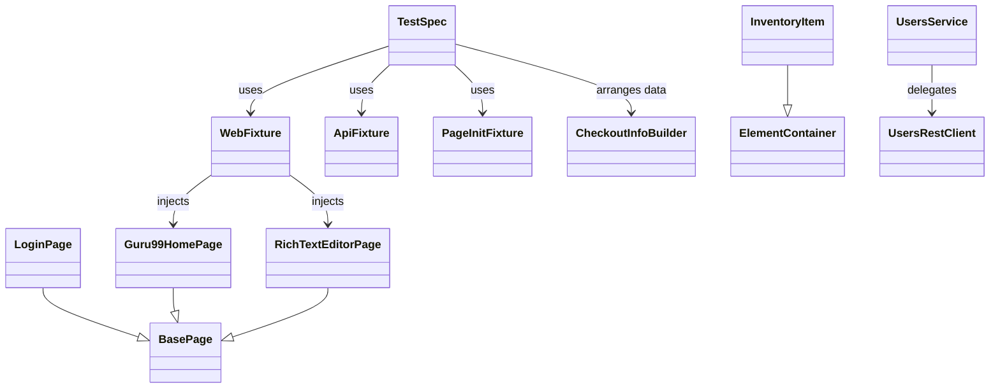

# Homework Assignment

Playwright and TypeScript test automation project with strict validation gates, fixture-based dependency injection, and a componentized Page Object Model.

## Technology Overview

- **Language:** TypeScript
- **Test framework:** Playwright (`@playwright/test`)
- **Assertions:** Playwright web-first assertions
- **Linting:** Biome + ESLint (`eslint-plugin-playwright`)
- **Type checking:** `tsc --noEmit`
- **Hooks:** Husky + lint-staged
- **Package manager:** npm
- **Node version management:** `.nvmrc`
- **API test support:** custom REST client + service layer

## Project Setup

1. Install the project Node.js version:
   ```bash
   nvm install
   nvm use
   ```
2. Install dependencies:
   ```bash
   npm install
   ```
3. Install Playwright browsers locally:
   ```bash
   npx playwright install
   ```
4. Run the full local gate:
   ```bash
   npm run check:all
   ```

### Prerequisites

- Node.js version from `.nvmrc`
- npm
- local Playwright browser installation
- credential file at `test/resources/credential.json` for SauceDemo login scenarios

## Local Execution

| Command | Purpose |
|---|---|
| `npm run typecheck` | TypeScript validation |
| `npm run lint` | Biome + ESLint |
| `npm run check` | Typecheck + lint |
| `npm run test` | Playwright tests with `pretest` |
| `npm run test:raw` | Playwright tests only |
| `npm run check:all` | Full local validation |
| `npm run test:headed` | Headed browser run |
| `npm run test:ui` | Playwright UI mode |
| `npm run ci` | CI-equivalent local pipeline |

## Test Runtime Configuration

- **Primary UI base URL:** `https://www.saucedemo.com/`
- **Configured test id attribute:** `data-test`
- **Browser matrix:** Chromium, Firefox, WebKit
- **Retries:** 4 locally, 1 on CI
- **Tracing:** enabled on first retry
- **Reporters:**
  - local: HTML + JSON + JUnit
  - CI: blob reporter for shard merge

## Test Automation Architecture

### Architectural Patterns

- **Fixture-based DI:** fixtures create and inject reusable test dependencies
- **Componentized Page Object Model (C-POM):** page-level objects compose reusable UI components
- **Element Container pattern:** repeated DOM structures are wrapped as typed containers
- **Service + API client split:** low-level HTTP integration and higher-level domain logic stay separate
- **Test Data Builder:** structured test input is created through builders instead of hardcoded literals
- **Page initialization fixture:** SauceDemo session bootstrap is centralized and reusable

### Repository Layout

```text
src/
  api/           generic API client + domain REST clients
  config/        tags, credentials, shared config values
  fixtures/      Playwright fixture composition
  page-objects/  pages and reusable UI containers
  services/      domain services
  test-data/     builders and test input models
  tests/         Playwright specs
```

### Dependency Overview



### Fixture Layers

- **`page-init.fixture.ts`** wires the core SauceDemo pages and optional authenticated session
- **`web.fixture.ts`** wires standalone third-party UI pages used by browser tests
- **`api.fixture.ts`** wires API clients and services for REST-focused scenarios

This split keeps each spec focused on only the dependencies it needs.

### Componentized Page Object Model

This project does not keep all selectors flat inside a single page class. Repeated UI blocks are extracted into dedicated containers such as `InventoryItem` and `CartItem`, then composed back into page objects such as `InventoryPage` and `CartPage`. That keeps page objects smaller and makes list-like UI reusable and type-safe.

### TypeScript Conventions

Two TypeScript styles are used intentionally:

1. **Constructor injection** for mandatory runtime dependencies:
   ```ts
   constructor(page: Page) {
       this.page = page;
   }
   ```
   or parameter properties:
   ```ts
   constructor(
       private readonly usersRestClient: UsersRestClient,
       loggerFactory: LoggerFactoryService,
   ) {}
   ```
2. **Inline readonly fields** for locators and page structure:
   ```ts
   readonly usernameInput = this.root.getByTestId("username");
   readonly loginButton = this.root.getByTestId("login-button");
   ```

The constructor is used for injected collaborators. Inline readonly fields are used for stable locators derived from those collaborators.

## Engineering Practices

### Expected

- `async/await` everywhere
- web-first assertions
- strict TypeScript
- stable locators
- reusable fixtures and page objects
- builders for structured input
- tests focused on behavior rather than implementation noise

### Avoid

- `test.only`
- `waitForTimeout`
- broad branching in test bodies
- ignored lint or type errors
- low-level locator duplication across tests

## Quality Gates

The project enforces a layered validation pipeline:

1. **Biome** for fast repository-wide checks and formatting
2. **ESLint** for Playwright-specific rules on tests and config
3. **TypeScript** with `tsc --noEmit`
4. **Husky pre-commit** to run staged-file linting plus full checks
5. **Playwright test suite** as the final local and CI gate

Recommended local flow:

```bash
npm run check
npm run check:all
```

### What is validated

- repository-wide formatting and lint discipline
- Playwright-specific testing rules
- TypeScript correctness
- local execution across the configured browser projects
- pre-commit validation before code is committed

## Continuous Integration Workflow

The main workflow lives in `.github/workflows/playwright.yml`.

### Pipeline Stages

1. **install-dependencies** - prepares dependencies and Playwright browsers
2. **run-quality-checks** - runs `npm run check`
3. **discover-shards** - calculates the Playwright shard matrix
4. **execute-tests** - runs Playwright shards in parallel
5. **merge-reports** - merges blob reports into HTML and JSON outputs

### Dependency Distribution and Caching

The workflow uses both persistent cache and same-run artifact sharing:

- **npm cache** via `actions/setup-node`
- **`node_modules` cache** keyed by OS + `.nvmrc` + `package-lock.json`
- **Playwright browser cache** keyed by OS + `.nvmrc` + `package-lock.json`
- **Artifacts shared between jobs in the same run:**
  - `node-modules`
  - `playwright-browsers`
  - `blob-report-*`

Artifacts used for same-run reuse are kept for **7 days**. Cache invalidation happens automatically when the Node version or dependency lockfile changes.

### Reporting

CI produces merged:

- **HTML report**
- **JSON report**
- per-shard **blob reports** used only for merge

### CI Exclusions and Constraints

Some tests are intentionally limited in CI because they depend on third-party sites:

- **Case 3:** skipped on **WebKit** because the external CKEditor page is not stable there in headless CI
- **Case 4:** tagged with **`@skip-ci`** because the external Guru99 flow is blocked in CI by anti-bot protection

CI excludes `@skip-ci` tests through Playwright config, while local runs can still execute them.

### External System Dependencies

The suite depends on multiple external systems:

- SauceDemo for primary UI scenarios
- Guru99 for iframe and multi-tab behavior
- onlinehtmleditor.dev for rich text editor behavior
- user API integration through the custom REST client layer

Where these systems are unstable or anti-bot protected, exclusions are documented explicitly instead of hiding failures with blanket retries.
